# Проект Docker_Compose

## Часть 1. Запуск нескольких Docker-контейнеров с использованием Docker Compose

### Шаги выполнения

#### 1.1 Написание Dockerfile для каждого микросервиса

##### Базовый образ

В `pom.xml` каждого сервиса указано `<java.version>8</java.version>` — проект написан на **Java 8**.

Однако в материалах проекта (`materials/04-project_rus.md`) дана рекомендация:
> «Теперь в Dockerfile на базе, например, `openjdk:21-jdk-alpine`, достаточно указать инструкции...»

**Почему JDK 21, если проект на Java 8?**
- Java обратно совместима (backward compatible): код, написанный на Java 8, будет работать на JDK 21
- Свежий JDK 21 — более производительный, безопасный, с новыми возможностями JIT-компилятора
- Материалы проекта явно рекомендуют `openjdk:21-jdk-alpine`
- Alpine-версия даёт минимальный размер образа

**Для этапа сборки (builder) выбрали вариант:**

**Выбор:** `maven:3.9-eclipse-temurin-21-alpine`

**Для этапа запуска (runtime):**

| Образ | Плюсы | Минусы |
|-------|-------|--------|
| `eclipse-temurin:21-jdk-alpine`  |  JDK 21, Alpine, официально поддерживается | Содержит JDK |
| ~~`openjdk:21-jdk-alpine`~~ | Образ удалён из Docker Hub | Не существует |

**Выбор:** `eclipse-temurin:21-jdk-alpine` — современная замена `openjdk` от Eclipse Foundation, официально поддерживается.

> **Важно:** Образ `openjdk:21-jdk-alpine` больше не существует на Docker Hub. OpenJDK образы были удалены, их заменил `eclipse-temurin`. При сборке с `openjdk` вы получите ошибку: `failed to resolve source metadata: not found`.

Схема сервисов

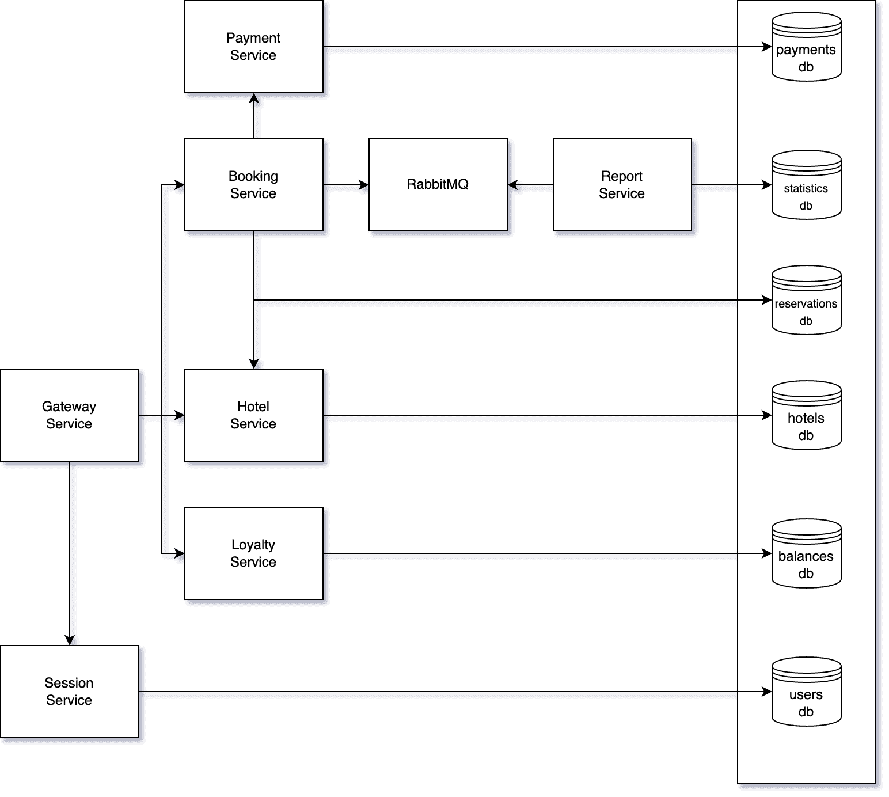

[booking_service/Dokerfile](./services/booking-service/Dockerfile)

[gateway-service/Dockerfile](./services/gateway-service/Dockerfile)

[hotel-service/Dockerfile](./services/hotel-service/Dockerfile)

[loyalty-service/Dockerfile](./services/loyalty-service/Dockerfile)

[payment-service/Dockerfile](./services/payment-service/Dockerfile)

[report-service/Dockerfile](./services/report-service/Dockerfile)

[session-service/Dockerfile](./services/session-service/Dockerfile)

[database](./services/database/init.sql)
---

##### Файл `.env` — переменные окружения

Для хранения общих настроек создан файл `src/.env`:


Docker Compose автоматически подхватывает переменные из `.env`, если он лежит в той же папке, что и `docker-compose.yml`.

**Важно:** Пользователь RabbitMQ `guest` по умолчанию может подключаться **только с localhost**. Для подключения из Docker-контейнеров нужно создать своего пользователя через переменные `RABBITMQ_DEFAULT_USER` и `RABBITMQ_DEFAULT_PASS` в определении сервиса rabbitmq.

---

##### Инициализация баз данных (init.sql)

В материалах (`04-project_rus.md`) сказано:
> «Популяция начальными значениями баз данных postgres производится соответствующими сервисами автоматически, но сами базы данных надо создать, запустив скрипт `src/services/database/init.sql`»

**Как это работает:**
1. **Сами БД (databases)** создаются скриптом `init.sql` — он создаёт 6 баз: `users_db`, `hotels_db`, `reservations_db`, `payments_db`, `balances_db`, `statistics_db`
2. **Таблицы внутри БД** создаются автоматически самими Spring-сервисами через Hibernate (настройка `spring.jpa.hibernate.ddl-auto=create`)
3. **Начальные данные** (тестовые отели, пользователи) тоже заполняются сервисами через `InitializeData.java` и `data.sql`

**В docker-compose.yml** мы смонтируем `init.sql` в специальную папку PostgreSQL:
```yaml
volumes:
  - ./services/database/init.sql:/docker-entrypoint-initdb.d/init.sql
```
PostgreSQL **автоматически** выполняет все `.sql` файлы из `/docker-entrypoint-initdb.d/` при первом запуске контейнера.

---

##### Пошаговое создание Dockerfile для session-service

**Файл:** [session-service/Dockerfile](./services/session-service/Dockerfile)

**Шаг 1 — выбор базового образа для сборки:**
```dockerfile
FROM maven:3.9-eclipse-temurin-21-alpine AS builder
```
- `FROM` — указываем, с какого образа начинаем
- `maven:3.9-eclipse-temurin-21-alpine` — содержит Maven 3.9 и JDK 21 на Alpine
- `AS builder` — даём этапу имя builder, чтобы на него ссылаться

> **Почему не `mvnw` (Maven Wrapper)?** — В проекте есть `mvnw`, настроенный на Maven 3.8.1. При запуске через `./mvnw` внутри контейнера возникает ошибка `Unknown lifecycle phase "/root/.m2"`. Так как образ `maven:3.9-eclipse-temurin-21-alpine` **уже содержит Maven 3.9**, используем системную команду `mvn` вместо `./mvnw`.

**Шаг 2 — рабочая директория:**
```dockerfile
WORKDIR /app
```
- Все последующие команды (`COPY`, `RUN`) будут выполняться внутри папки `/app`

**Шаг 3 — копирование файлов для загрузки зависимостей:**
```dockerfile
COPY pom.xml ./
```
- `pom.xml` — описание зависимостей проекта
- ‼️ **Почему не копируем весь код сразу?** — Docker кэширует каждый слой. Если скопировать всё сразу, то при любом изменении кода зависимости будут переустанавливаться. Разделяя копирование (сначала зависимости, потом код), мы кэшируем слой зависимостей.
- **Не копируем `mvnw` и `.mvn/`:** используем системный Maven (`mvn`), а не Maven Wrapper (`./mvnw`), чтобы избежать ошибок совместимости версий

**Шаг 4 — загрузка зависимостей:**
```dockerfile
RUN mvn dependency:go-offline -B
```
- `mvn` — системная команда Maven (доступна в образе `maven:3.9-eclipse-temurin-21-alpine`)
- `dependency:go-offline` — скачивает ВСЕ библиотеки из Maven Central
- `-B` — batch mode (без лишних вопросов)
- Этот слой закэшируется и не будет пересобираться, пока не изменится `pom.xml`

**Шаг 5 — копирование исходного кода:**
```dockerfile
COPY src src
```
- Теперь копируем весь исходный код (меняется часто)

**Шаг 6 — сборка .jar:**
```dockerfile
RUN mvn package -DskipTests -B
```
- `package` — создаёт исполняемый .jar файл в папке `target/`
- `-DskipTests` — пропускаем тесты (будем прогонять отдельно через Postman)
- Используем `mvn` вместо `./mvnw` — системный Maven не вызывает ошибок с аргументами

**Шаг 7 — установка bash (только для Alpine):**
```dockerfile
RUN apk add --no-cache bash
```
- `wait-for-it.sh` использует `#!/usr/bin/env bash`, но в Alpine по умолчанию нет `bash` — только `sh`
- Без `bash` получите ошибку: `env: 'bash': No such file or directory`
- `apk add --no-cache bash` устанавливает bash (~5MB к образу)

**Шаг 8 — начало второго этапа (runtime):**
```dockerfile
FROM eclipse-temurin:21-jdk-alpine AS runtime
```
- Начинаем с чистого листа! Берём JDK 21 на Alpine от Eclipse Temurin
- ‼️ **Важно:** образ `openjdk:21-jdk-alpine` **удалён из Docker Hub**. Используйте `eclipse-temurin` — официальную замену.
- **Альтернатива:** `eclipse-temurin:21-jre-alpine` (ещё меньше, только среда выполнения)

**Шаг 9 — копирование .jar из этапа сборки:**
```dockerfile
COPY --from=builder /app/target/*.jar ./app.jar
```
- `--from=builder` — берём файл из этапа с именем builder
- Переименовываем в `app.jar` для удобства

**Шаг 10 — копирование скрипта ожидания БД:**
```dockerfile
COPY wait-for-it.sh /usr/local/bin/wait-for-it.sh
RUN chmod +x /usr/local/bin/wait-for-it.sh
```
- `wait-for-it.sh` — скрипт, который ждёт, пока TCP-порт станет доступен
- Нужен, чтобы сервис не запустился раньше PostgreSQL (БД стартует дольше)
- Использует `#!/usr/bin/env bash` — поэтому нужен установленный `bash`

**Шаг 11 — указание порта:**
```dockerfile
EXPOSE 8081
```
- Информационная инструкция (не открывает порт — это делает `ports` в docker-compose.yml)

**Шаг 12 — команда запуска:**
```dockerfile
CMD ["wait-for-it.sh", "-t", "60", "$POSTGRES_HOST:$POSTGRES_PORT", "--", "java", "-jar", "app.jar"]
```
- `-t 60` — ждать максимум 60 секунд
- `$POSTGRES_HOST:$POSTGRES_PORT` — адрес PostgreSQL
- **Про exec-form CMD:** В JSON-формате (`["cmd", "arg"]`) переменные НЕ раскрываются shell'ом. `$POSTGRES_HOST` передаётся как литерал. Но `wait-for-it.sh` без флага `-s` (strict) запускает команду даже при ошибке, а Java читает переменные из среды напрямую.
- Для сервисов с несколькими зависимостями (booking, report) используется shell-форма: `CMD ["sh", "-c", "..."]`

---

##### Пошаговое создание Dockerfile для gateway-service

**Файл:** [gateway-service/Dockerfile](./services/gateway-service/Dockerfile)

**Этапы те же, что и для session-service, но есть отличия:**

1. **Нет своей БД** — gateway-service общается с другими микросервисами только по HTTP
2. **Не требует `wait-for-it.sh` для БД** — если нужно ждать session-service, можно добавить:
   ```dockerfile
   CMD ["wait-for-it.sh", "-t", "60", "$SESSION_SERVICE_HOST:$SESSION_SERVICE_PORT", "--", "java", "-jar", "app.jar"]
   ```
3. **Порт 8087** — `EXPOSE 8087`
4. **Переменные окружения** — вместо `POSTGRES_*` используются `SESSION_SERVICE_*`, `HOTEL_SERVICE_*`, `BOOKING_SERVICE_*`, `PAYMENT_SERVICE_*`, `LOYALTY_SERVICE_*`, `REPORT_SERVICE_*`

---

- [x] **Dockerfile для session-service** (`src/services/session-service/Dockerfile`) 
  - Builder: `maven:3.9-eclipse-temurin-21-alpine`
  - Runtime: `openjdk:21-jdk-alpine`
  - Multi-stage build, `wait-for-it.sh` для PostgreSQL

- [x] **Dockerfile для gateway-service** (`src/services/gateway-service/Dockerfile`) 
  - Builder: `maven:3.9-eclipse-temurin-21-alpine`
  - Runtime: `openjdk:21-jdk-alpine`
  - Multi-stage build, без `wait-for-it.sh` (нет своей БД)

- [x] **Dockerfile для hotel-service** (`src/services/hotel-service/Dockerfile`)  — полный аналог session-service (порт 8082, hotels_db)
- [x] **Dockerfile для booking-service** (`src/services/booking-service/Dockerfile`)  — ждёт PostgreSQL + RabbitMQ (port 8083, reservations_db)
- [x] **Dockerfile для payment-service** (`src/services/payment-service/Dockerfile`)  — полный аналог session-service (порт 8084, payments_db)
- [x] **Dockerfile для loyalty-service** (`src/services/loyalty-service/Dockerfile`)  — полный аналог session-service (порт 8085, balances_db)
- [x] **Dockerfile для report-service** (`src/services/report-service/Dockerfile`)  — ждёт PostgreSQL + RabbitMQ (порт 8086, statistics_db)

- [x] **Создан файл `.env`** (`src/.env`)  — общие переменные окружения

#### 1.2 Написание docker-compose.yml

**Файл:**  [docker-compose.yml](./docker-compose.yml)

Docker Compose — это инструмент для описания и запуска многоконтейнерных приложений. В одном файле мы описываем все сервисы (контейнеры), их взаимосвязи, порты, переменные окружения и volumes.

---

##### Общая структура docker-compose.yml

```yaml
version: "3.8"                # версия формата Docker Compose
services:                      # раздел с описанием всех сервисов
  postgres:                    # имя сервиса = hostname в Docker-сети
    image: postgres:16-alpine  # готовый образ с Docker Hub (не собираем)
    ...
  session-service:             # наш микросервис
    build: ./services/session-service  # путь к папке с Dockerfile
    ...
volumes:                       # раздел с описанием постоянных томов
  postgres_data:
```

---

##### Сервис postgres (база данных)

```yaml
postgres:
  image: postgres:16-alpine
  container_name: postgres_s21
  restart: unless-stopped
  environment:
    POSTGRES_USER: ${POSTGRES_USER}       # берётся из .env
    POSTGRES_PASSWORD: ${POSTGRES_PASSWORD}
  ports:
    - "5432:5432"
  volumes:
    - ./services/database/init.sql:/docker-entrypoint-initdb.d/init.sql
    - postgres_data:/var/lib/postgresql/data
  healthcheck:
    test: ["CMD", "pg_isready", "-U", "${POSTGRES_USER}"]
    interval: 10s
    timeout: 5s
    retries: 5
```

**Ключевые моменты:**

1. **`image: postgres:16-alpine`** — используем готовый официальный образ PostgreSQL (версия может быть изменена пользователем)
2. **`${POSTGRES_USER}`** — переменные из файла `.env`, Docker Compose подставляет их автоматически
3. **`volumes` (init.sql):** `./services/database/init.sql` монтируется в `/docker-entrypoint-initdb.d/`. PostgreSQL **автоматически** выполняет все .sql файлы из этой папки при первом запуске
4. **`volumes` (named volume):** `postgres_data` — данные БД сохраняются даже после перезапуска контейнера
5. **`healthcheck`** — проверка здоровья `pg_isready`. Позволяет другим сервисам ждать не просто запуска, а готовности БД (`condition: service_healthy`)

---

##### Сервис rabbitmq (очередь сообщений)

```yaml
rabbitmq:
  image: rabbitmq:3-management-alpine
  container_name: rabbitmq
  restart: unless-stopped
  environment:
    # Создаём своего пользователя (guest подключается ТОЛЬКО с localhost)
    RABBITMQ_DEFAULT_USER: ${RABBIT_MQ_USER}
    RABBITMQ_DEFAULT_PASS: ${RABBIT_MQ_PASSWORD}
  ports:
    - "5672:5672"    # AMQP — порт для подключения сервисов
    - "15672:15672"  # Management UI — веб-интерфейс
```

**`rabbitmq:3-management-alpine`**
- тег `management` — включает веб-интерфейс (порт 15672) для просмотра очередей
- `alpine` — минимальный размер
- **Важно:** без `RABBITMQ_DEFAULT_USER/PASS` пользователь `guest` не может подключаться удалённо → ошибка `ACCESS_REFUSED`

---

##### Простые сервисы (только БД): session, hotel, payment, loyalty

Все четыре устроены одинаково. Разберём session-service:

```yaml
session-service:
  build: ./services/session-service       # сборка из Dockerfile
  container_name: session-service
  restart: unless-stopped
  ports:
    - "${SESSION_SERVICE_PORT}:8081"       # хост:контейнер (8081:8081)
  environment:
    POSTGRES_HOST: postgres                # имя сервиса = hostname в Docker-сети
    POSTGRES_PORT: ${POSTGRES_PORT}        # 5432
    POSTGRES_USER: ${POSTGRES_USER}
    POSTGRES_PASSWORD: ${POSTGRES_PASSWORD}
    POSTGRES_DB: users_db                  # своя БД
  depends_on:
    postgres:
      condition: service_healthy           # ждём готовности PostgreSQL
```

**Важно:**
- `POSTGRES_HOST: postgres` — имена сервисов внутри одной Docker-сети преобразуются в IP-адреса автоматически (встроенный DNS)
- У каждого сервиса своя `POSTGRES_DB`: session → `users_db`, hotel → `hotels_db`, payment → `payments_db`, loyalty → `balances_db`
- `condition: service_healthy` — ждём, пока PostgreSQL пройдёт healthcheck

---

##### Средние сервисы (БД + RabbitMQ): report-service, booking-service

**report-service:** — БД (`statistics_db`) + RabbitMQ:

```yaml
report-service:
  build: ./services/report-service
  environment:
    POSTGRES_DB: statistics_db
    RABBIT_MQ_HOST: rabbitmq
    RABBIT_MQ_PORT: ${RABBIT_MQ_PORT}
    RABBIT_MQ_USER: ${RABBIT_MQ_USER}
    RABBIT_MQ_PASSWORD: ${RABBIT_MQ_PASSWORD}
    RABBIT_MQ_QUEUE_NAME: ${RABBIT_MQ_QUEUE_NAME}
    RABBIT_MQ_EXCHANGE: ${RABBIT_MQ_EXCHANGE}
  depends_on:
    postgres:
      condition: service_healthy
    rabbitmq:
      condition: service_started
```

**booking-service (сложнее):** — БД + RabbitMQ + HTTP-зависимости:

```yaml
booking-service:
  build: ./services/booking-service
  environment:
    POSTGRES_DB: reservations_db
    RABBIT_MQ_HOST: rabbitmq
    RABBIT_MQ_PORT: ${RABBIT_MQ_PORT}
    # HTTP-зависимости (обращается к ним по HTTP внутри Docker-сети)
    HOTEL_SERVICE_HOST: hotel-service
    HOTEL_SERVICE_PORT: ${HOTEL_SERVICE_PORT}
    PAYMENT_SERVICE_HOST: payment-service
    PAYMENT_SERVICE_PORT: ${PAYMENT_SERVICE_PORT}
    LOYALTY_SERVICE_HOST: loyalty-service
    LOYALTY_SERVICE_PORT: ${LOYALTY_SERVICE_PORT}
  depends_on:
    postgres:
      condition: service_healthy
    rabbitmq:
      condition: service_started
    hotel-service:
      condition: service_started
    payment-service:
      condition: service_started
    loyalty-service:
      condition: service_started
```

**booking-service ждёт hotel, payment, loyalty?**
- В коде booking-service есть HTTP-вызовы к этим сервисам (см. `диаграмму`)
- `depends_on` гарантирует порядок запуска контейнеров
- `condition: service_started` = контейнер запущен, но не гарантирует готовность приложения внутри. Полную готовность по TCP обеспечивает `wait-for-it.sh` в Dockerfile (ждёт PostgreSQL и RabbitMQ)

---

##### Шлюз: gateway-service (без БД)

```yaml
gateway-service:
  build: ./services/gateway-service
  container_name: gateway-service
  restart: unless-stopped
  ports:
    - "${GATEWAY_SERVICE_PORT}:8087"      # порт для Postman-тестов
  environment:
    SESSION_SERVICE_HOST: session-service
    SESSION_SERVICE_PORT: ${SESSION_SERVICE_PORT}
    HOTEL_SERVICE_HOST: hotel-service
    HOTEL_SERVICE_PORT: ${HOTEL_SERVICE_PORT}
    BOOKING_SERVICE_HOST: booking-service
    BOOKING_SERVICE_PORT: ${BOOKING_SERVICE_PORT}
    PAYMENT_SERVICE_HOST: payment-service
    PAYMENT_SERVICE_PORT: ${PAYMENT_SERVICE_PORT}
    LOYALTY_SERVICE_HOST: loyalty-service
    LOYALTY_SERVICE_PORT: ${LOYALTY_SERVICE_PORT}
    REPORT_SERVICE_HOST: report-service
    REPORT_SERVICE_PORT: ${REPORT_SERVICE_PORT}
  depends_on:
    session-service: { condition: service_started }
    hotel-service: { condition: service_started }
    booking-service: { condition: service_started }
    payment-service: { condition: service_started }
    loyalty-service: { condition: service_started }
    report-service: { condition: service_started }
```

**Почему gateway не использует `wait-for-it.sh`?**
- У gateway НЕТ своей БД
- Он только шлёт HTTP-запросы к другим сервисам
- Если сервис ещё не готов — gateway получит ошибку и повторит попытку

---

**Порты, доступные с хост-машины:**

| Порт хоста | Куда ведёт | Назначение |
|:----------:|------------|------------|
| `8087` | gateway-service | Основной API (Postman-тесты) |
| `8081` | session-service | Прямой доступ (отладка) |
| `5432` | postgres | Доступ к БД (опционально) |
| `5672` | rabbitmq | AMQP для отладки |
| `15672` | rabbitmq | Веб-интерфейс управления очередями |

---

##### Файл .env — переменные окружения

**Файл:** `src/.env`

Docker Compose автоматически подгружает переменные из `.env`, если он лежит рядом с `docker-compose.yml`. Все `${ИМЯ_ПЕРЕМЕННОЙ}` в docker-compose.yml берутся отсюда:

| Переменная | Значение | Описание |
|-----------|----------|----------|
| `POSTGRES_USER` | `postgres` | Пользователь БД |
| `POSTGRES_PASSWORD` | `postgres` | Пароль БД |
| `POSTGRES_PORT` | `5432` | Порт PostgreSQL |
| `RABBIT_MQ_USER` | `guest` | Пользователь RabbitMQ |
| `RABBIT_MQ_PASSWORD` | `guest` | Пароль RabbitMQ |
| `RABBIT_MQ_PORT` | `5672` | Порт RabbitMQ AMQP |
| `SESSION_SERVICE_PORT` | `8081` | Порт session-service |
| `HOTEL_SERVICE_PORT` | `8082` | Порт hotel-service |
| `BOOKING_SERVICE_PORT` | `8083` | Порт booking-service |
| `PAYMENT_SERVICE_PORT` | `8084` | Порт payment-service |
| `LOYALTY_SERVICE_PORT` | `8085` | Порт loyalty-service |
| `REPORT_SERVICE_PORT` | `8086` | Порт report-service |
| `GATEWAY_SERVICE_PORT` | `8087` | Порт gateway-service |

**Преимущества `.env`:**
- Не дублируем одинаковые значения (пароли, порты)
- Можно менять настройки без правки docker-compose.yml
- Безопасность: `.env` можно добавить в `.gitignore`

#### 1.3 Сборка и запуск

- [x] `docker-compose build` — выполнено (41.5 сек) 
- [x] `docker-compose up -d` — выполнено 
- [x] `docker-compose ps` — все 9 контейнеров запущены 
- [x] `docker-compose logs` — ошибки исправлены 

##### Ошибки при сборке и их исправление

| № | Ошибка | Причина | Исправление |
|:-:|--------|---------|-------------|
| 1 | `failed to resolve source metadata for docker.io/library/openjdk:21-jdk-alpine: not found` | Образ `openjdk` удалён из Docker Hub | Заменён на `eclipse-temurin:21-jdk-alpine` |
| 2 | `Unknown lifecycle phase "/root/.m2"` | Maven Wrapper конфликтует с аргументами | Используем системный `mvn` вместо `./mvnw` |
| 3 | `env: 'bash': No such file or directory` | Alpine без `bash`, а `wait-for-it.sh` требует bash | Добавлен `RUN apk add --no-cache bash` |
| 4 | `FATAL: role "postgres" does not exist` | Пользователь БД не совпадает с `OWNER` в init.sql | Согласован пользователь в .env и init.sql |
| 5 | `AuthenticationFailureException: ACCESS_REFUSED` | `guest` в RabbitMQ подключается только с localhost | Создан кастомный пользователь через `RABBITMQ_DEFAULT_USER/PASS` |
| 6 | `Access to DialectResolutionInfo cannot be null` | БД `reservations_db`, `statistics_db` не созданы (init.sql не выполнился из-за volume) | Сброшен volume и перезапущен `docker-compose up -d` |

##### Итоговый статус контейнеров

```
NAME              IMAGE                    STATUS                  PORTS
postgres_s21      postgres:16-alpine       Up (healthy)            5432
rabbitmq          rabbitmq:3-management    Up                      5672, 15672
session-service   src-session-service      Up                      8081
hotel-service     src-hotel-service        Up                      8082
booking-service   src-booking-service      Up                      8083
payment-service   src-payment-service      Up                      8084
loyalty-service   src-loyalty-service      Up                      8085
report-service    src-report-service       Up                      8086
gateway-service   src-gateway-service      Up                      8087
```

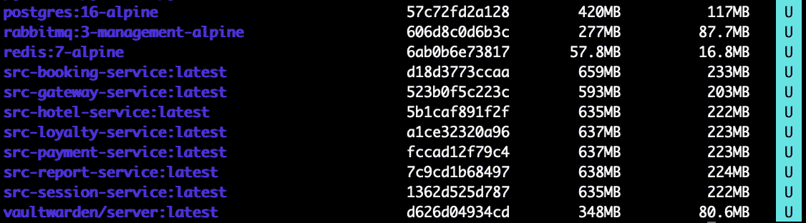

#### 1.4 Тестирование через Postman

- [x] Импортировать коллекцию `application_tests.postman_collection.json` в Postman 
- [x] Запустить тесты (коллекция -> Run) 
- [x] Все 5 тестов пройдены успешно 
- [x] Сделаны скриншоты результатов тестирования 

**Запуск тестирования**

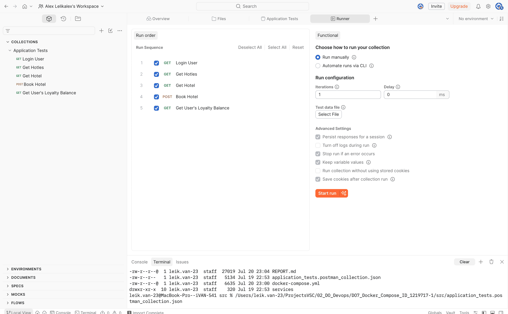

**Результаты тестирования:**

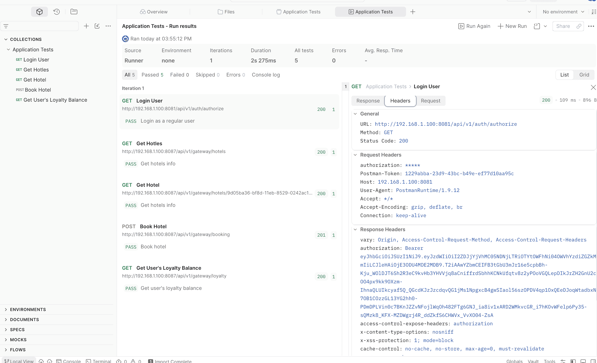
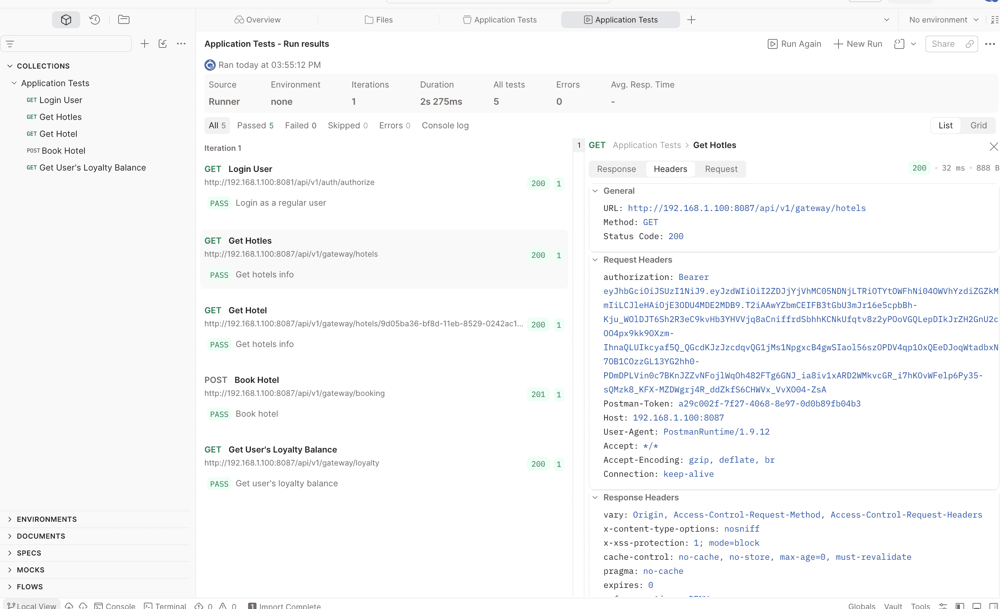
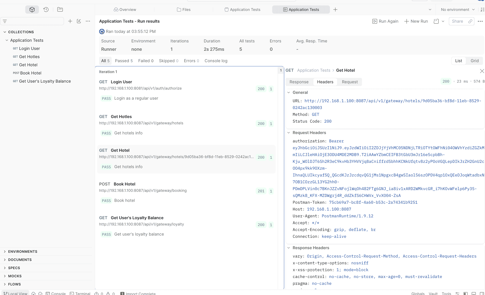
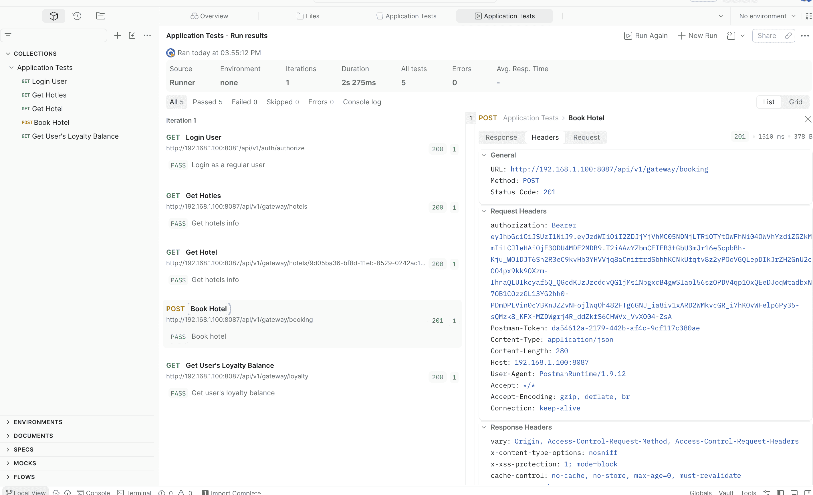
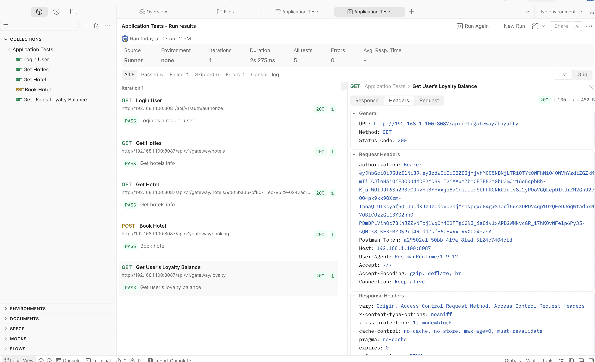

**Общий результат**
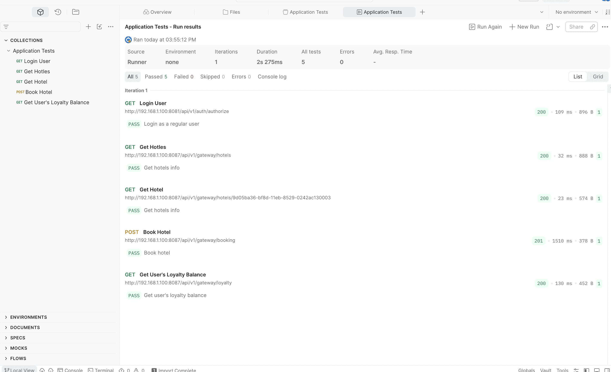

#### 1.5 Отчёт по размерам образов

- [x] Выполнить `docker images` для просмотра размеров 
- [x] Выполнить `docker history <имя_образа>` для просмотра слоёв 

---

### Результаты выполнения

#### Размеры образов (`docker images`)

| Образ | CONTENT SIZE | Описание |
|-------|:-----------:|----------|
| `src-session-service:latest` | 222 MB | session-service (port 8081) |
| `src-hotel-service:latest` | 222 MB | hotel-service (port 8082) |
| `src-booking-service:latest` | 233 MB | booking-service (port 8083) |
| `src-payment-service:latest` | 223 MB | payment-service (port 8084) |
| `src-loyalty-service:latest` | 223 MB | loyalty-service (port 8085) |
| `src-report-service:latest` | 224 MB | report-service (port 8086) |
| `src-gateway-service:latest` | 203 MB | gateway-service (port 8087) |
| `postgres:16-alpine` | 117 MB | База данных PostgreSQL |
| `rabbitmq:3-management-alpine` | 87.7 MB | Очередь сообщений RabbitMQ |

**Наблюдения:**
- Размеры Java-сервисов ~200-233 MB — это ожидаемо, т.к. Eclipse Temurin JDK 21 на Alpine весит ~160 MB + ~40-60 MB сам jar с зависимостями
- Gateway-service самый лёгкий (203 MB) — у него меньше зависимостей (нет Hibernate, PostgreSQL драйвера)
- Booking-service самый тяжёлый (233 MB) — у него больше всего зависимостей (Hibernate + RabbitMQ + HTTP-клиенты)
- Multi-stage build позволил уменьшить размер: без него образ с Maven + JDK весил бы >400 MB

#### Просмотр слоёв образа (`docker history src-session-service:latest`)

```bash
docker history src-session-service:latest
```
```
IMAGE          CREATED        CREATED BY                                             SIZE
1362d525d787   16 hours ago   CMD ["wait-for-it.sh" "-t" "60" ...]                   0B
<missing>      16 hours ago   EXPOSE [8081/tcp]                                      0B
<missing>      16 hours ago   RUN chmod +x wait-for-it.sh                            4.1kB
<missing>      16 hours ago   COPY wait-for-it.sh /usr/local/bin/                    24.6kB
<missing>      16 hours ago   COPY /app/target/*.jar ./app.jar                       42.8MB  ← наш .jar
<missing>      16 hours ago   WORKDIR /app                                           8.19kB
<missing>      16 hours ago   RUN apk add --no-cache bash                            1.97MB  ← bash
<missing>      4 weeks ago    ...слои базового образа eclipse-temurin:21-jdk-alpine...
<missing>      4 weeks ago    ADD alpine-minirootfs...                               9.07MB  ← Alpine Linux
```

**Анализ слоёв:**
- **Alpine Linux** — 9 MB (основа)
- **Eclipse Temurin JDK 21** — 307 MB + 51 MB (сборка JDK)
- **Наш application.jar** — 42.8 MB (код + зависимости)
- **bash** — 1.97 MB (для wait-for-it.sh)
- **wait-for-it.sh** — 24.6 kB
- **Итого:** ~222 MB (CONTENT SIZE)

#### Результаты тестирования Postman


**Все 5 тестов пройдены успешно** 

---

## Часть 2. Создание виртуальных машин

### Задание

> Установить и инициализировать Vagrant в корне проекта. Написать Vagrantfile для одной виртуальной машины. Перенести исходный код в рабочую директорию VM. Зайти через консоль внутрь, проверить код. Остановить и уничтожить VM.

### Чек-лист выполнения

- [x] **Установлен Vagrant 2.4.9** на homeserver (Linux)
  - Скачан .deb с releases.hashicorp.com через VPN на Mac, передан на сервер через SCP
  - Установка: `sudo dpkg -i /tmp/vagrant.deb && sudo apt install -f`

- [x] **Установлен плагин vagrant-libvirt** 
  - Прямой доступ к `gems.hashicorp.com` заблокирован (гео-блокировка CloudFront)
  - Решение: создан конфиг с явным указанием rubygems.org
  - Команда: `vagrant plugin install vagrant-libvirt --plugin-clean-sources --plugin-source https://rubygems.org`
- [x] **Создан `Vagrantfile`** — **универсальный**  (корень проекта) 
  - Linux → libvirt (KVM)
  - Mac/Windows → VirtualBox
- [x] **Запустить VM:** `vagrant up`
- [x] **Проверить код внутри VM:** `vagrant ssh` → `ls /home/vagrant/src`
- [x] **Уничтожить VM:** `vagrant destroy -f`

---

#### Vagrantfile (универсальный)

**Файл:** '/src/Vagrantfile'

**Автоопределение ОС** (Ruby код в начале файла):
```ruby
RUBY_PLATFORM =~ /linux/   → libvirt
RUBY_PLATFORM =~ /darwin/  → VirtualBox
RUBY_PLATFORM =~ /mingw/   → VirtualBox
```

**Настройки для Linux (libvirt):**
| Параметр | Значение |
|----------|----------|
| box | `generic/ubuntu2204` |
| memory | 2048 MB |
| cpus | 2 |
| synced_folder | `rsync` (стандарт для libvirt) |

**Настройки для Mac/Windows (VirtualBox):**
| Параметр | Значение |
|----------|----------|
| box | `generic/ubuntu2204` |
| memory | 2048 MB |
| cpus | 2 |
| synced_folder | `virtualbox` (shared folders) |
| forwarded_port | 8087 и 8081 |

#### Команды для запуска

**На homeserver (Linux):**
```bash
# Установка (один раз)
sudo apt update && sudo apt install -y vagrant libvirt-daemon-system libvirt-clients qemu-kvm
sudo systemctl enable --now libvirtd
vagrant plugin install vagrant-libvirt

# Запуск
cd /data/workspace/projects/DO7_Docker_Compose_ID_1219717-1
vagrant up --provider=libvirt
```

**На Mac:**
```bash
cd /Users/leik.van-23/ProjectsVSC/02_DO_Devops/DO7_Docker_Compose_ID_1219717-1
vagrant up          # запуск VM (~5 мин в первый раз)
```
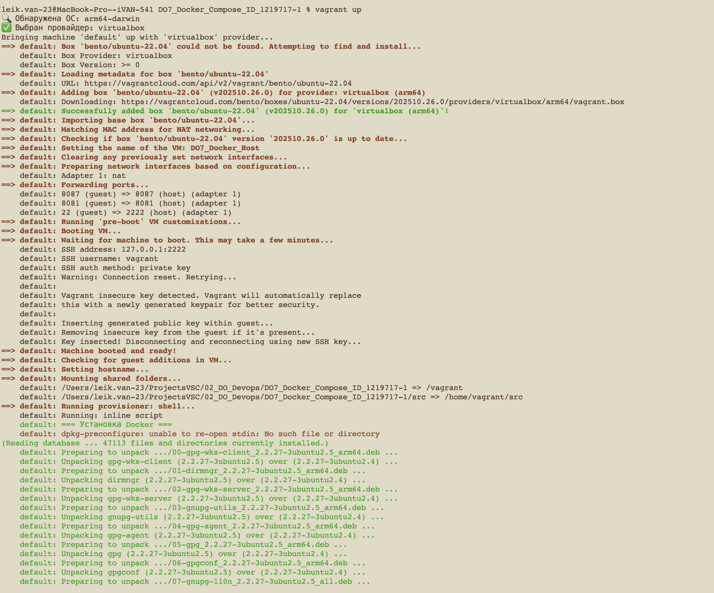

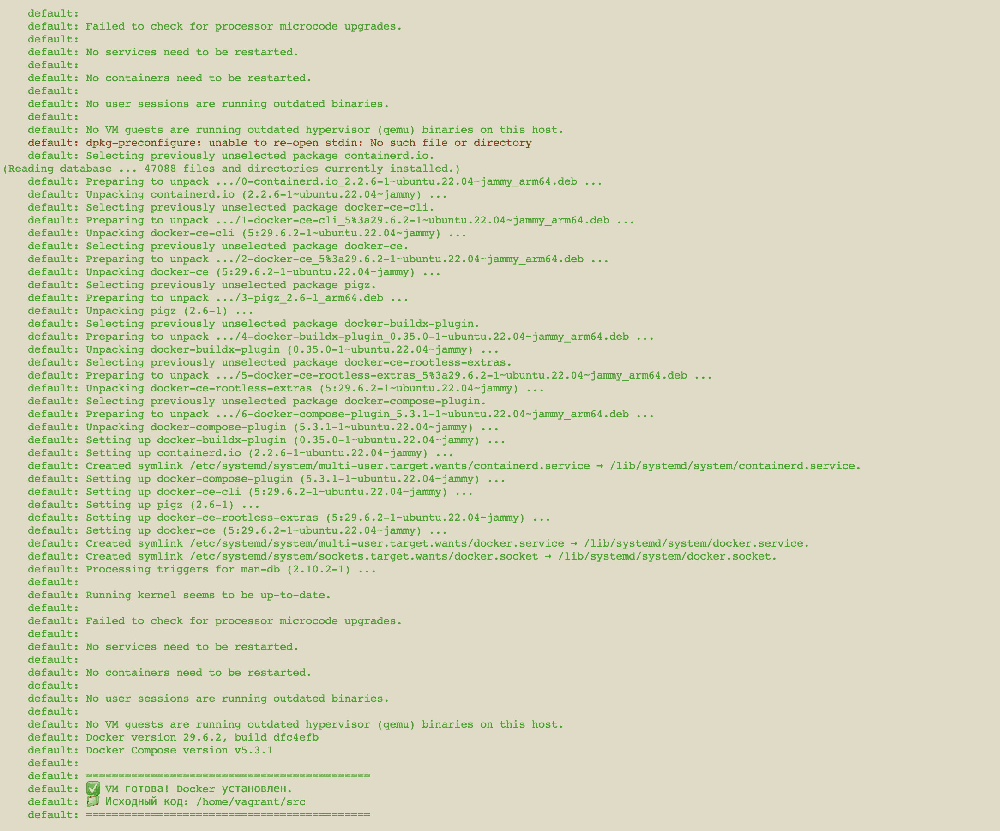

#### Результат

```bash
vagrant ssh
vagrant@docker-host:~$ ls /home/vagrant/src/
docker-compose.yml  .env  REPORT.md  services/

vagrant@docker-host:~$ docker --version
Docker version 27.x.x
```
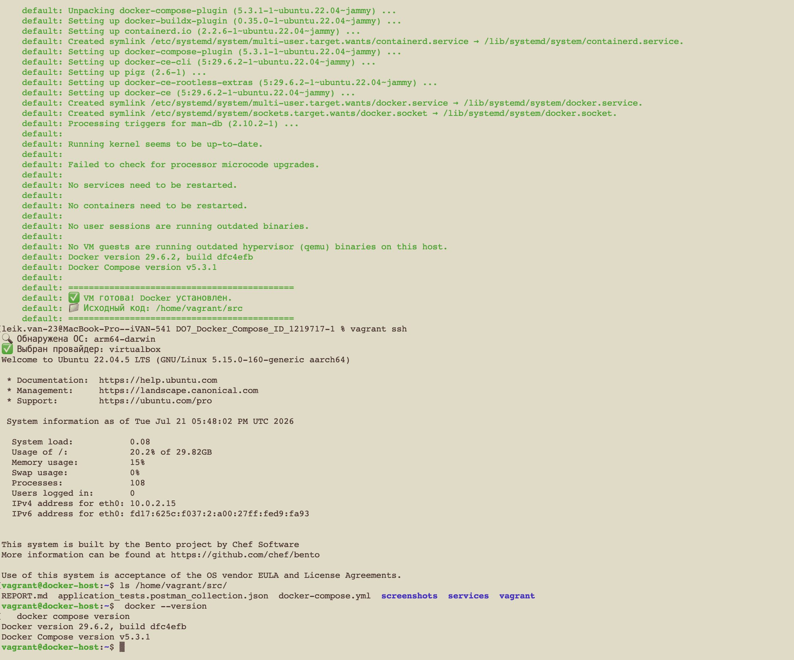

```bash                   # выйти
vagrant destroy -f  # уничтожить VM
```
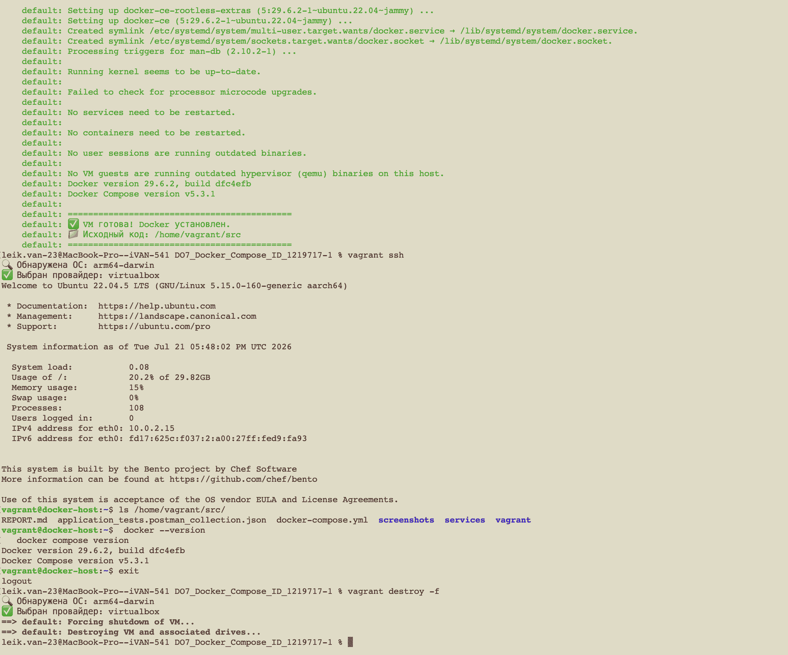

---

## Часть 3. Создание простейшего Docker Swarm

### Чек-лист

- [x] Модифицировать Vagrantfile для 3 машин (manager01, worker01, worker02)
- [x] Написать shell-скрипты установки Docker и инициализации Swarm
- [x] Загрузить образы на Docker Hub
- [x] Модифицировать docker-compose.yml для подгрузки образов с Docker Hub
- [x] Поднять VM и перенести docker-compose.yml на manager
- [x] Запустить стек сервисов (`docker stack deploy`)
- [x] Настроить nginx proxy для доступа к gateway и session service
- [x] Скрыть прямой доступ к gateway и session service
- [x] Прогнать тесты Postman
- [x] Отобразить распределение контейнеров по узлам (`docker service ps`)
- [x] Установить Portainer отдельным стеком
- [x] Отобразить визуализацию Portainer

                               
### Задание 1. Создание трёх ВМ и Docker Swarm                                                
                                                         
#### Vagrantfile для 3 машин

**Файл:** [Vagrantfile](./Vagrantfile)                          
                                                                                                  
  | ВМ | Hostname | IP (private network) | Роль |                                                 
  |:--:|----------|:--------------------:|------|                                                 
  | manager01 | `manager01` | 192.168.100.100 | Manager (leader) |                                
  | worker01 | `worker01` | 192.168.100.101 | Worker |                                            
  | worker02 | `worker02` | 192.168.100.102 | Worker |                                            
                                                                                                  
  - **Провайдер:** libvirt (KVM)                                                                  
  - **Базовый образ:** `generic/ubuntu2204`                                                       
  - **Ресурсы:** 1024 MB RAM, 1 CPU                                                               
  - **Синхронизация:** rsync (`src/ → /home/vagrant/src`)                                       
                                                                                                  
  #### Shell-скрипты
                                                                                
  - [scripts/install_docker.sh](./scripts/install_docker.sh) — установка Docker Engine + Compose                               
  - [scripts/init_swarm.sh](./scripts/init_swarm.sh) — `docker swarm init --advertise-addr 192.168.100.100` + сохранение   
токена                                                                                            
  - [scripts/join_swarm.sh](./scripts/join_swarm.sh) — получение токена из shared-папки и `docker swarm join`

  - [scripts/vagrant_up.sh](./scripts/vagrant_up.sh) Запуск и поднятие 3 виртуальных машин

  #### Проблемы и решения                                                
  | Проблема | Решение |                                                                          
  |----------|---------|                                                                          
  | rsync однонаправленный (токен не виден workers) | После manager01 токен копируется на хост:   
`vagrant ssh manager01 -- "cat ..." > ./src/worker_token` |                                       
  | vagrant up запускает ВМ параллельно | Последовательный запуск: `vagrant up manager01 &&       
vagrant up worker01 worker02` |                                                                   
  | SSH-ключи разные на разных ВМ | Передача токена через shared-папку |                          
  | Trigger after :provision не срабатывает | Trigger не выполняется при `vagrant up` |           
                                                                                                  
  #### Результат: кластер Docker Swarm                                                          
                                                                                                  
```                                                                     
ID                           HOSTNAME    STATUS    AVAILABILITY   MANAGER STATUS   ENGINE VERSION 
a4guwk68ypibglmowq39jm9gb *  manager01   Ready     Active         Leader           29.6.2         
zu33lwdc3x4camtjd4afv2elk    worker01    Ready     Active                          29.6.2         
ril6inmkn3cqrgca5fq5eek72    worker02    Ready     Active                          29.6.2         
                  
```                

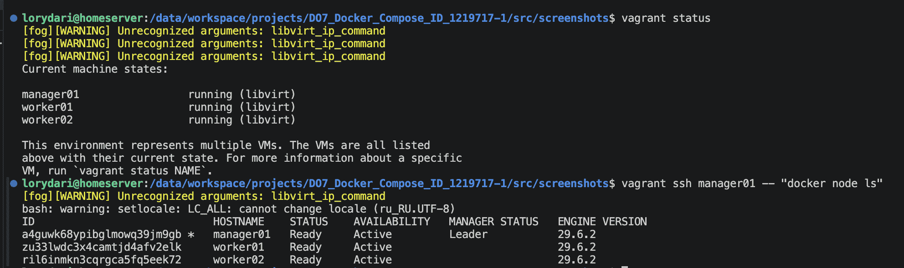

  ---                                                                                                             
### Задание 2. Загрузка образов на Docker Hub                                                 
                                                                                                  
#### Загрузка образов                                                                           
  ```bash                                                           
  docker tag src-session-service:latest <логин>/session-service:latest                            
  # ... для всех 7 сервисов                                                                       
  docker push <логин>/session-service:latest                                                      
  # ... для всех 7 сервисов                                                                       
```

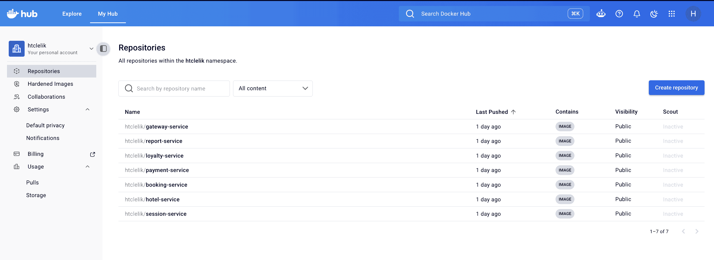
                                                   
                                                                                                  
- [x] Перенести docker-compose.yml на manager
```bash
rsync -avhP --rsync-path="sudo rsync" "/data/workspace/projects/DO7_Docker_Compose_ID_1219717-1/src/docker-compose-swarm.yml" vagrant@192.168.100.100:/home/vagrant/src/
rsync -avhP --rsync-path="sudo rsync" "/data/workspace/projects/DO7_Docker_Compose_ID_1219717-1/src/.env" vagrant@192.168.100.100:/home/vagrant/src/
rsync -avhP --rsync-path="sudo rsync" "/data/workspace/projects/DO7_Docker_Compose_ID_1219717-1/src/services/database/init.sql" vagrant@192.168.100.100:/home/vagrant/src/
```                                                    
- [x] docker stack deploy -c docker-compose.yml app
### Задание 3. Запуск стека сервисов                                                                                   
  #### Развёртывание на кластере                                                                  
                                                                                                  
  Для запуска на кластере Docker Swarm создан отдельный файл
  
  [docker-compose-swarm.yml](./docker-compose-swarm.yml), адаптированный под swarm mode: 

  | Изменение | Причина |                                                                         
  |-----------|---------|                                                                         
  | `build:` → `image:` | В swarm образы должны быть на Docker Hub |                              
  | Удалены `container_name:` | Не поддерживается в swarm |                                       
  | `configs:` вместо `volumes` | Для init.sql используется docker config |                       
  | `depends_on:` — список имён | В swarm не поддерживается `condition:` |                        
  | Добавлен сервис `db-init` | Создаёт 6 БД после старта postgres (CREATE DATABASE) |            
                                                                                                  
  #### Проблемы и решения                                                                         
                                                                                                  
  | Проблема | Решение |                                                                          
  |----------|---------|                                                                          
                                                          
  | `${VAR}` не подставляются в swarm | Swarm не читает `.env` автоматически. Создан скрипт       
`source .env` перед `deploy` |                                                                    
  | wait-for-it.sh `need host and port` | Переменные не были переданы в контейнер — исправлено    
через `source .env` |                                                                             
                                                                                                  
  #### Итоговый скрипт запуска

[deploy.sh](./deploy.sh)

```bash
cd src
./deploy.sh
```
#### Результат: все 9 сервисов Running  

- [x] docker stack services s21

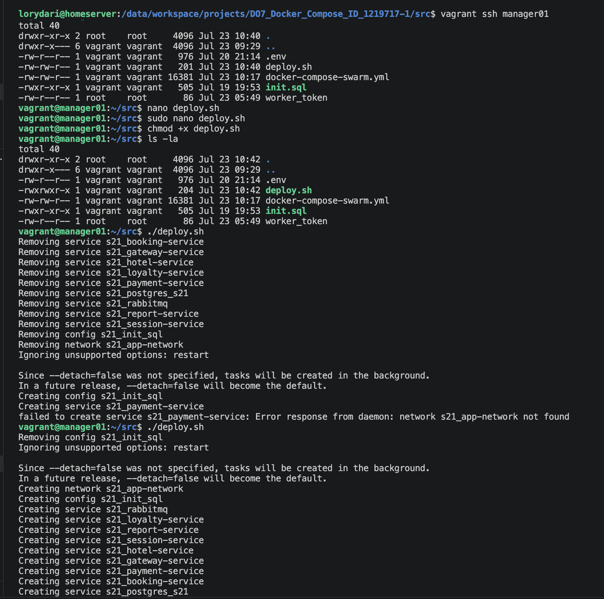

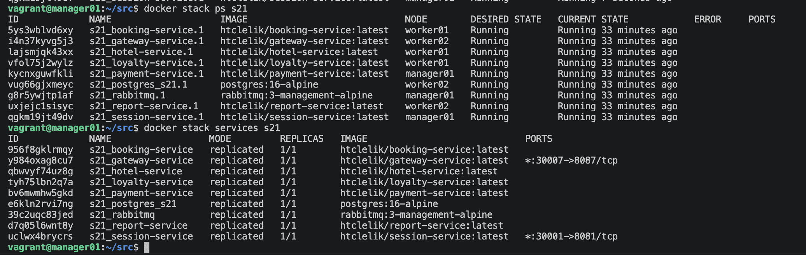
                     
 ### Задание 4. nginx proxy

 - [x] Создать конфиг nginx для gateway + session

 [nginx/default.conf](./nginx/default.conf)

 - [x] Изменить конфиг docker compose

 [docker-compose-swarm-nginx.yml](./docker-compose-swarm-nginx.yml)

 - [x] Запустить как сервис в Swarm

 [Deploy Swarm with Nginx](./deploy_with_nginx.sh)

Добавлен сервис nginx:alpine, который проксирует запросы к gateway и session:                     


 Проверка изоляции:                                                                                
 - localhost:30080/api/v1/auth/authorize → 200                                                   
 - localhost:30080/api/v1/gateway/hotels → 200                                                   
 - localhost:30007/api/v1/gateway/hotels → ❌ Connection refused (заблокирован)                    
 - localhost:30001/api/v1/auth/authorize → ❌ Connection refused (заблокирован)

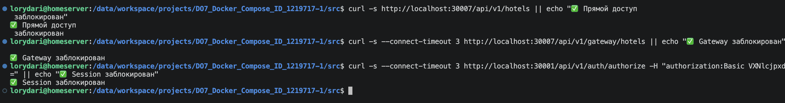                 
                                                                                                   
 ### Задание 5. Postman тесты                                                                    
                                                                                                   
 Тесты пройдены через SSH-туннель (localhost:30080 → manager01:30080):                             
 Запуск туннеля ssh -L 30080:192.168.100.100:30080 username#server -p 22                                                                                                
 **Результаты тестирования:**

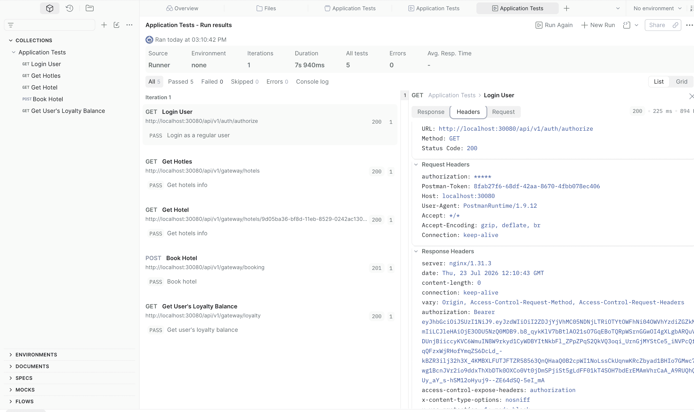
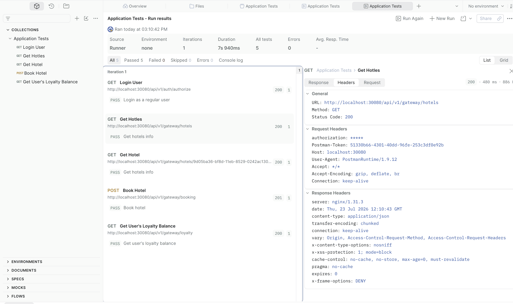
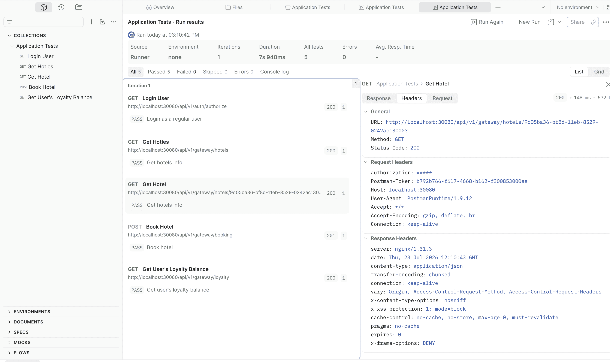
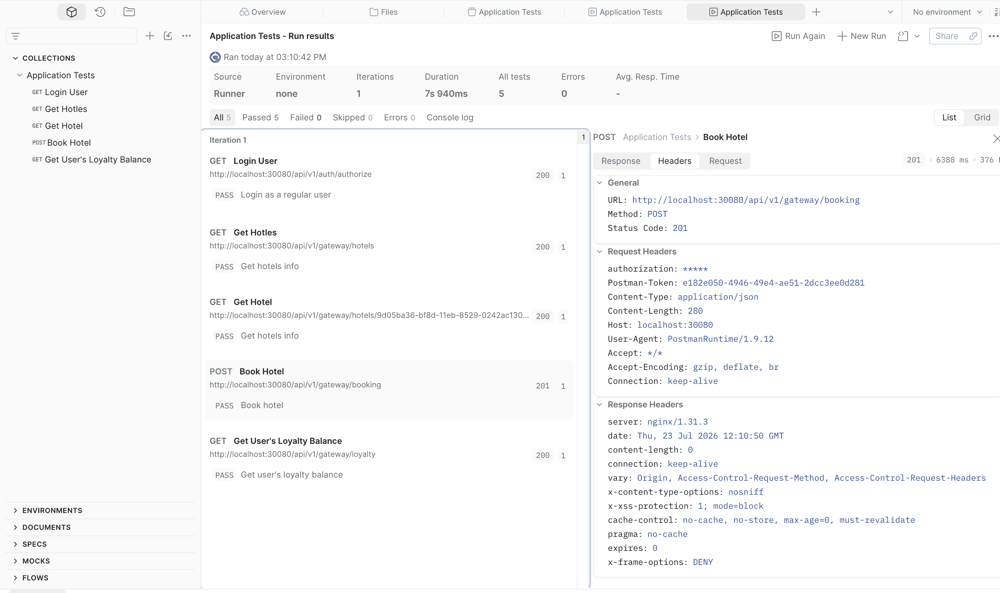
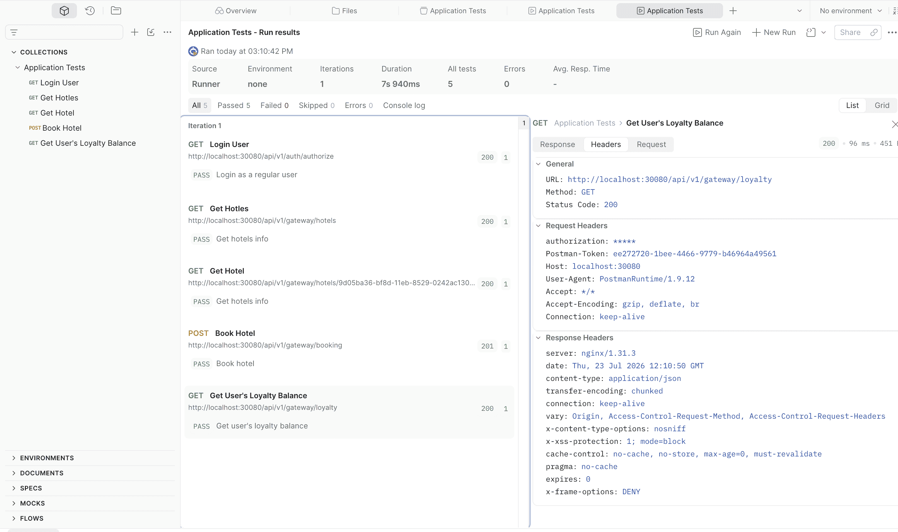

 ### Задание 6. Распределение контейнеров по узлам                                               
                                                                 
 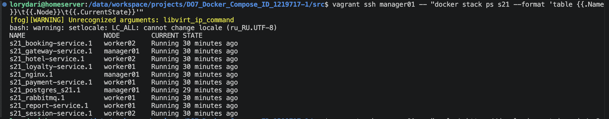                            
                                                                                                   
 ### Задание 7. Portainer                                                                        
                                                                                                   
 Portainer 2.19.5 установлен отдельным стеком на кластере:

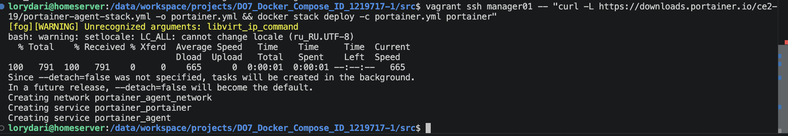

 - portainer_portainer — веб-интерфейс (порт 9000)

 - portainer_agent — агент на каждом узле (manager01, worker01, worker02) 

 Запуск туннеля ssh -L 9000:192.168.100.100:9000 username#server -p 22 

 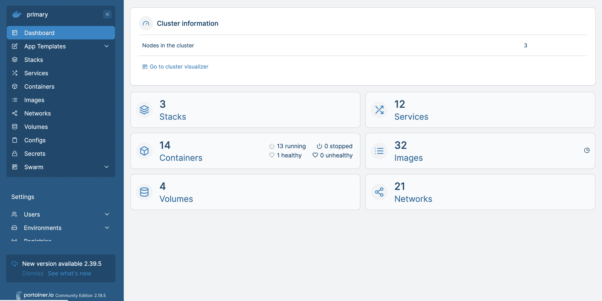

  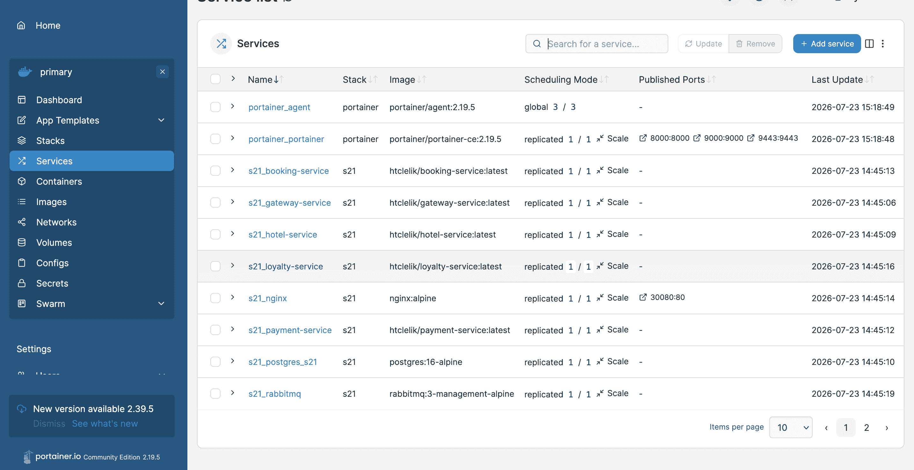

 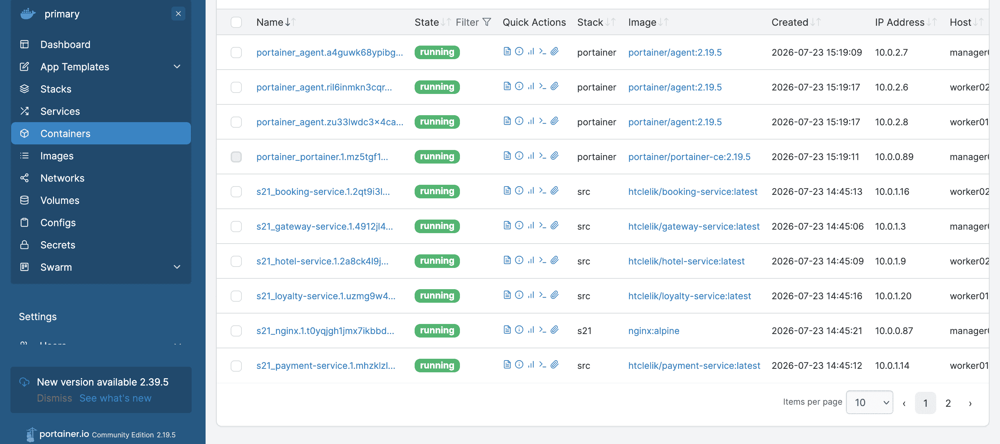


 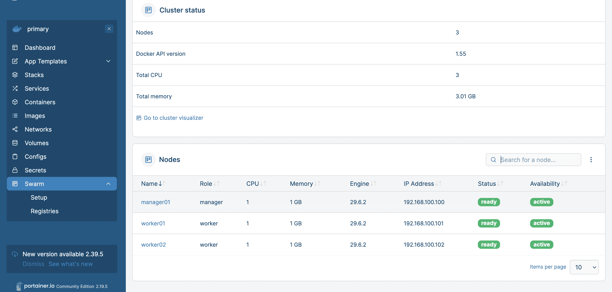

 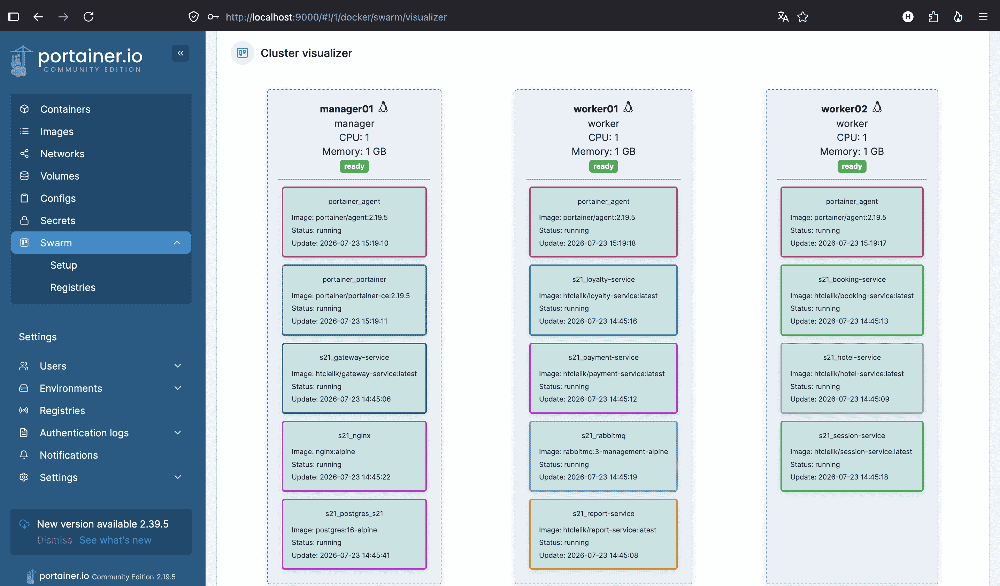

 

 
 
